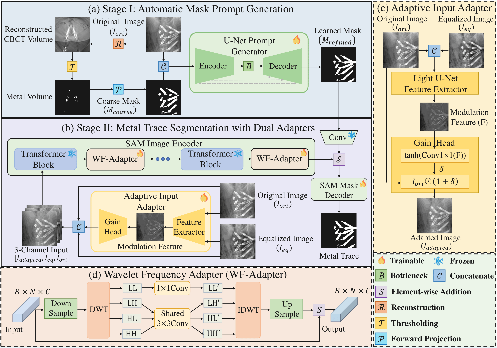
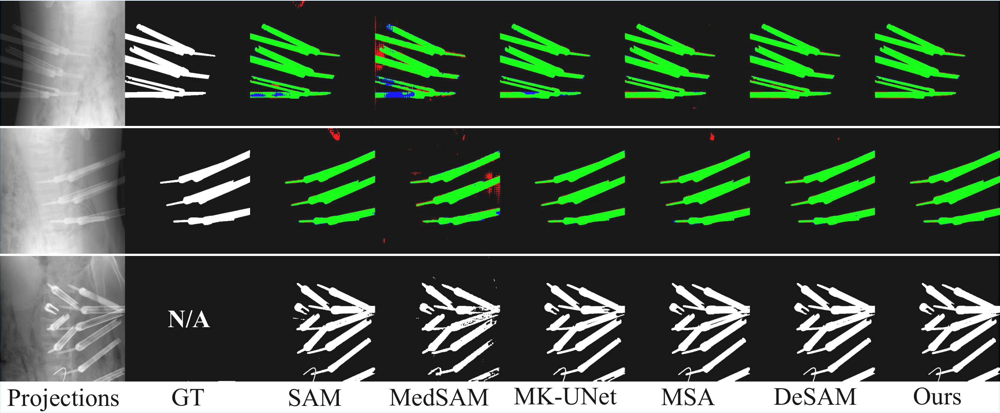

# DA-SAM: Dual-Adapter SAM with Learned Mask Prompts for CBCT Projection-Domain Metal Trace Segmentation

Official implementation of DA-SAM for CBCT projection-domain metal trace segmentation.

## Abstract

Accurate segmentation of metal traces within the cone-beam computed tomography (CBCT) projection domain is a fundamental but challenging task for metal artifact reduction (MAR). As a prompt-driven foundation model, the Segment Anything Model (SAM) holds great potential for improving projection-domain metal trace segmentation. However, several challenges must be addressed before applying SAM in this setting. First, the domain gap between natural images and CBCT projections leads to performance degradation. Second, SAM's image encoder, optimized for natural scenes, has limited capability in capturing the high-frequency boundaries of metal traces. Third, SAM's heavy dependency on high-quality prompts creates a bottleneck for metal trace segmentation. To address these issues, we propose Dual-Adapter SAM (DA-SAM). DA-SAM incorporates three key components: an Adaptive Input Adapter (AIA) that bridges the domain gap by modulating features between raw and histogram-equalized projections; a Wavelet Frequency Adapter (WFA), which captures high-frequency metal boundaries via the discrete wavelet transform and compensates for the limitations of SAM's image encoder in modeling subtle structures; and a Mask Prompt Generator (MPG) that fuses coarse mask priors with raw projections via a U-Net to synthesize high-quality mask prompts, thereby eliminating the need for manual interaction. Extensive experiments on clinical CBCT datasets demonstrate that DA-SAM achieves superior segmentation performance.

## Framework



## Repository

```text
DA_SAM_new/
|-- assets/
|-- code/
|   |-- preprocess/
|   |-- datasets/
|   |-- models/
|   |-- utils/
|   |-- train_stage1.py
|   |-- train_stage2.py
|   |-- test_stage1.py
|   `-- test_stage2.py
|-- configure/
|-- requirements.txt
`-- README.md
```

Main entry points:

- `code/preprocess/reconstruct_from_mat.py`
- `code/preprocess/project_metal_trace.py`
- `code/preprocess/equalize_projection.py`
- `code/preprocess/export_png_slices.py`
- `code/train_stage1.py`
- `code/train_stage2.py`
- `code/test_stage1.py`
- `code/test_stage2.py`

## Installation

Install DA-SAM:

```bash
git clone https://github.com/3067348049/DA_SAM
cd DA_SAM_new
pip install -r requirements.txt
```

Exact tested package versions are listed in `requirements.txt`.

Place the SAM checkpoint at:

```text
checkpoints/sam_vit_b_01ec64.pth
```

### Optional: Install CTorch for preprocessing

`code/preprocess/` depends on CTorch. If you already have prepared `proj_img / Eq_proj_img / proj_metal / metal_trace_label`, you can skip this part.

```bash
conda create -n dasam_ct python=3.9
conda activate dasam_ct
pip install pybind11
pip install git+https://github.com/JHU-AIAI-Shared/AIAI-CTorch-Public.git@main
```

Or install from a local CTorch copy:

```bash
cd path/to/AIAI-CTorch-Public
python setup.py install
```

Check CTorch:

```bash
python -c "import CTorch; print('CTorch is available')"
```

## Data

The dataset is private. Only the expected directory layout is shown here.

```text
data/
|-- proj_img/
|   `-- sampleXX/*.png
|-- Eq_proj_img/
|   `-- sampleXX/*.png
|-- proj_metal/
|   `-- sampleXX/*.png
`-- metal_trace_label/
    `-- sampleXX/*.png
```

Filenames must stay aligned across the four folders for each sample.

## Pipeline

### 1. Optional preprocessing from `.mat`

Reconstruct CBCT volumes:

```bash
python code/preprocess/reconstruct_from_mat.py ^
  --data_dir path\\to\\mat_files ^
  --seq_dir path\\to\\geometry_seq ^
  --out_dir path\\to\\preprocess\\recon ^
  --gpu_idx 0
```

Generate `proj_img`, `proj_metal`, and labels:

```bash
python code/preprocess/project_metal_trace.py ^
  --recon_dir path\\to\\preprocess\\recon ^
  --mat_dir path\\to\\mat_files ^
  --seq_dir path\\to\\geometry_seq ^
  --out_dir path\\to\\preprocess\\proj ^
  --threshold 0.08 ^
  --gpu_idx 0
```

Equalize projections:

```bash
python code/preprocess/equalize_projection.py ^
  --in_dir path\\to\\preprocess\\proj ^
  --out_dir path\\to\\preprocess\\eq
```

Export training PNG folders:

```bash
python code/preprocess/export_png_slices.py ^
  --proj_img_dir path\\to\\preprocess\\proj ^
  --eq_dir path\\to\\preprocess\\eq ^
  --proj_metal_dir path\\to\\preprocess\\proj ^
  --label_dir path\\to\\preprocess\\proj ^
  --out_dir path\\to\\data
```

### 2. Train

```bash
cd code
python train_stage1.py --gpu_idx 0
python train_stage2.py --gpu_idx 0
```

### 3. Test

```bash
cd code
python test_stage1.py --gpu_idx 0
python test_stage2.py --gpu_idx 0 --save_predictions
```

## Results

| Method | Dice | IoU | Precision | Recall | HD95 |
|--------|------|-----|-----------|--------|------|
| SAM-B | 0.9396 | 0.8879 | 0.9387 | 0.9419 | 10.21 |
| MK-UNet | 0.9506 | 0.9071 | 0.9503 | 0.9520 | 4.83 |
| MedSAM | 0.8543 | 0.7520 | 0.8495 | 0.8622 | 23.25 |
| MSA | 0.9481 | 0.9028 | 0.9369 | 0.9608 | 5.40 |
| DeSAM | 0.9513 | 0.9084 | 0.9473 | 0.9564 | 2.65 |
| **DA-SAM (Ours)** | **0.9567** | **0.9180** | **0.9523** | **0.9620** | **1.59** |

### Qualitative Comparison


